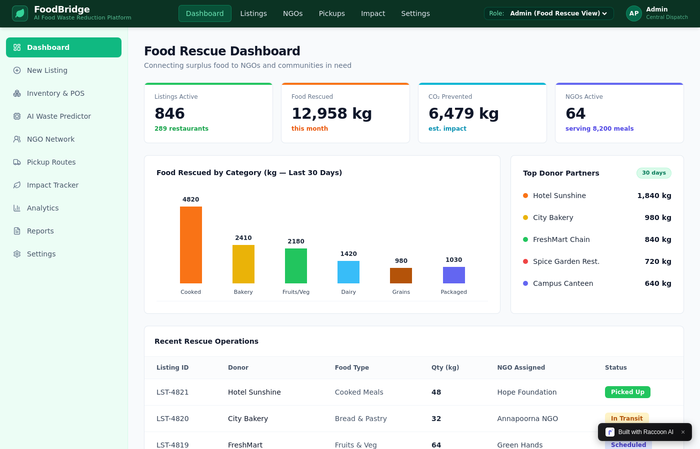

# 🥦 FoodBridge — AI-Based Food Redistribution System for Waste Reduction and Surplus Inventory Management

[](https://fastapi.tiangolo.com)
[](https://react.dev)
[](https://tailwindcss.com)
[](https://scikit-learn.org)
[](https://python.org)

> A full-stack AI-driven web platform enabling food businesses to track inventory with real-time expiry countdowns, receive machine-learning waste risk predictions, and connect with nearby recipient NGOs, shelters, and community kitchens before perishable food is wasted.

---

## 📸 Sample Platform Dashboard

Here is the central Food Rescue Operations Dashboard:



---

## 🌐 Live Interactive Demo

Access the live cloud preview:
👉 **[Launch Live Demo](https://wizard-sinking-eagle.3000.dev.raccoonai.tech)**

Switch between the 3 distinct role dashboards from the **Role** dropdown in the top navbar:
- **Admin View**: Global city-wide food rescue metrics, 30-day category distribution, donor leaderboard, and recent operations.
- **Donor View (Hotel Sunshine)**: Commercial kitchen view with inventory expiry watchlists, tax deduction valuation ($7,820 USD), and 1-click surplus posting.
- **NGO View (Hope Foundation)**: Community shelter view with intake capacity tracking, local available surplus feed, and driver dispatch coordination.

---

## 🚀 Key Modules & Capabilities

### 1. 📦 Inventory Management & Expiry Countdown Engine
- Automated shelf-life tracking:
  - `<24h CRITICAL` (triggers automated donation recommendation)
  - `<48h WARNING`
  - `<72h WATCH`
  - `HEALTHY`
- Food taxonomy classification across 6 categories (*Cooked, Bakery, Fruits & Veg, Dairy, Grains, Packaged*) and storage regimes (*Ambient, Chilled, Frozen*).
- Built-in **Barcode / QR Scanner Simulator** and **Bulk CSV Importer**.
- RESTful **POS Ingestion Sync API** (`POST /api/pos/sync`) simulating real-time checkout inventory deductions.

### 2. 🧠 AI Waste Risk Prediction Engine
- Trained **Gradient Boosting Regressor** (`scikit-learn`) capturing daily and weekly demand fluctuations.
- **Composite Waste Risk Score (0–100):**
  $$\text{Risk Score} = 0.50 \times \text{Expiry Urgency} + 0.35 \times \text{Oversupply Ratio} + 0.15 \times \text{Perishability Multiplier}$$
- **Smart Reorder Optimizer** calculating optimal inventory replenishment based on 7-day demand forecasts, safety buffers, and storage capacity limits.

### 3. 🤝 Redistribution Marketplace & AI Matching Engine
- Multi-criteria matching algorithm connecting surplus food listings to registered charities using:
  - **Geographic Proximity (Haversine formula)**
  - **Dietary & Category Acceptance** (*Veg, Non-Veg, Vegan, Halal*)
  - **Capacity Compatibility** (Matching batch kg against daily intake limits)
  - **Dynamic Urgency Weighting** (Prioritizing nearby charities when safe expiry is under 12 hours)

### 4. 🚚 Logistics Dispatch & Cold-Chain Verification
- 3-stage dispatch pipeline: `Scheduled` $\rightarrow$ `In Transit` $\rightarrow$ `Picked Up / Delivered`.
- Vehicle assignment, driver tracking, and temperature compliance check.

### 5. 📊 Analytics, Reports & ESG Certifications
- **Analytics View**: 6-month diversion trajectory (73.5% reduction in disposed waste), hourly peak surplus heatmaps, and ML accuracy benchmarks ($R^2 = 91.2\%$).
- **Reports & ESG Hub**: Generates certified GHG compliance statements, fair-market tax deduction ledgers, and downloadable CSV audits.

---

## 🛠️ Architecture & Tech Stack

```
foodbridge/
├── backend/
│   ├── database.py              # Multi-tenant SQLite schema & seed data
│   ├── main.py                  # FastAPI server & route handlers
│   ├── services/
│   │   ├── ai_engine.py         # Demand forecasting & waste risk scoring
│   │   ├── matching_engine.py   # Geospatial AI matching algorithm
│   │   ├── inventory_service.py # Expiry monitoring & POS ingestion
│   │   ├── pickup_service.py    # Logistics dispatch pipeline
│   │   └── analytics_service.py # Sustainability & ESG statistics
│   └── tests/
│       └── test_api.py          # Pytest test suite (8/8 passed)
├── frontend/
│   ├── src/
│   │   ├── components/
│   │   │   ├── DashboardView.jsx    # Dual-sided adaptive dashboard (Admin, Donor, NGO)
│   │   │   ├── InventoryView.jsx    # Inventory table, barcode scanner, CSV upload
│   │   │   ├── AiPredictionView.jsx # ML risk prediction & reorder optimizer
│   │   │   ├── MarketplaceView.jsx  # Surplus listings & AI matching drawer
│   │   │   ├── PickupsView.jsx      # Logistics dispatch queue
│   │   │   ├── ImpactView.jsx       # Environmental ESG metrics
│   │   │   ├── AnalyticsView.jsx    # Diversion trends & time-of-day heatmaps
│   │   │   └── ReportsView.jsx      # ESG certification audit & CSV export
│   │   ├── App.jsx
│   │   └── api.js
│   ├── package.json
│   └── tailwind.config.js
├── docs/images/                 # Dashboard screenshots
├── PROJECT_DOCUMENTATION.md     # Full architectural and algorithmic report
├── PRESENTATION_DECK.md         # 9-slide presentation script
└── requirements.txt             # Python dependencies
```

---

## 💻 Running Locally

### 1. Backend Setup (FastAPI)
```bash
# Clone the repository
git clone https://github.com/anjugummadi/foodbridge-ai.git
cd foodbridge-ai

# Create virtual environment and install dependencies
python3 -m venv venv
source venv/bin/activate
pip install -r requirements.txt

# Start backend server
python3 -m uvicorn backend.main:app --host 0.0.0.0 --port 8000
```
Interactive API docs available at: `http://localhost:8000/docs`

### 2. Frontend Setup (React + Vite)
```bash
cd frontend
npm install
npm run dev
```
Open `http://localhost:3000` in your browser.

### 3. Run Automated Tests
```bash
PYTHONPATH=. pytest backend/tests/test_api.py -v
```

---

## 📄 License
This project is developed under the MIT License.
